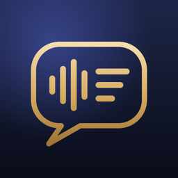

<p align="center">
  
</p>

<h1 align="center">AI-Notepad</h1>

<p align="center">
  A native macOS meeting notepad: live Finnish/English transcription, optional Turkish translation,
  and a Turkish post-meeting note that starts with <b>what you have to do</b>.
</p>

---

## Features

- **Live transcript** of both sides of a call: your microphone ("You") and the computer's audio
  (the other participants), with speaker separation.
- **Only the other side, if you want:** turn off "Also record my voice" and the microphone is never opened.
- **Optional live Turkish translation** in a floating glass panel and a notch "island".
- **Post-meeting note in Turkish:** your tasks first, then decisions, summary and a glossary.
  Long meetings (hours) are processed part by part, so no task gets lost.
- **Meeting library:** search, a Spotify-style player that highlights the spoken word, PDF/Markdown export,
  speaker naming, merging and AI suggestions ("Review speakers").
- **Assistant during the meeting:** "What did I miss?" and free questions about the conversation.
- **Engines:** Deepgram + ElevenLabs in the cloud, or fully on-device WhisperKit + SpeakerKit.
  LLM: Claude (default Claude Haiku 5.5) or any OpenAI-compatible server (OpenAI, Ollama, …).
- **Privacy:** API keys live only in the macOS Keychain; recordings stay on your Mac
  (`~/Library/Application Support/AINotepad`) and audio is deleted after a retention period you choose.
- English and Turkish user interface.

## Install

1. Download the latest `AI-Notepad-<version>.dmg` from [Releases](../../releases).
   The app is signed with a Developer ID and notarized by Apple.
2. Drag **AINotepad** to **Applications** and open it.
3. Follow the setup page: grant microphone and system-audio permissions and add your API keys
   (Deepgram, ElevenLabs, Anthropic — or choose the on-device engine and an OpenAI-compatible LLM).

Requirements: macOS 26 or later on Apple Silicon.

## Build from source

```bash
brew install xcodegen
cp Config/Local.xcconfig.example Config/Local.xcconfig   # put your DEVELOPMENT_TEAM here
xcodegen generate
xcodebuild -project AINotepad.xcodeproj -scheme AINotepad -configuration Debug \
  -derivedDataPath .build/xcode -destination 'platform=macOS,arch=arm64' build
scripts/install-app.sh          # Release build into /Applications (permissions persist)
```

Tests (Swift Testing):

```bash
swift test --package-path Packages/AINotepadCore                          # fast tests
AINOTEPAD_CLOUD_TESTS=1 swift test --package-path Packages/AINotepadCore  # + real Deepgram/ElevenLabs/Claude calls
```

Cloud tests read keys from the Keychain service `AINotepad`. Distribution builds are produced with
`scripts/release.sh` (Developer ID signing, notarization, stapled DMG).

Project layout: all logic lives in the Swift package `Packages/AINotepadCore` (with its tests);
`App/` contains only the SwiftUI/AppKit interface. Design notes are in `docs/superpowers/specs/`.

## Türkçe

AI-Notepad, Fince/İngilizce toplantıları canlı yazıya döken, istersen Türkçeye çeviren ve toplantı sonunda
**sana düşen görevlerle başlayan** Türkçe not hazırlayan bir macOS uygulamasıdır. Kurulum için
[Releases](../../releases) sayfasından DMG'yi indir, uygulamayı Uygulamalar klasörüne sürükle ve kurulum
sayfasındaki adımları izle. Anahtarlar yalnızca macOS Keychain'de, kayıtlar yalnızca Mac'inde tutulur.

## License

[Apache License 2.0](LICENSE) — see also [NOTICE](NOTICE).
